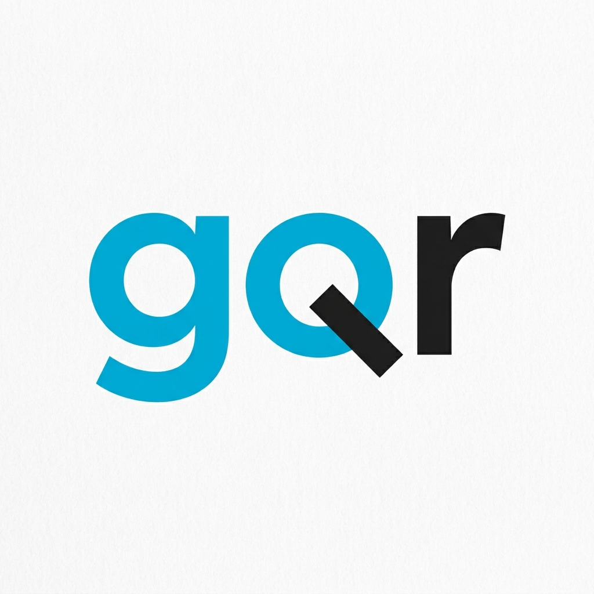

<p align="center">
  
</p>

# gqr

[](https://pkg.go.dev/github.com/wisebrian/gqr)
[](https://github.com/wisebrian/gqr/actions/workflows/ci.yml)

A QR code generator in Go, written using only the standard library.

- all versions 1–40 and error-correction levels L / M / Q / H
- the requested level is a minimum: if the symbol has room to spare, a higher level is used automatically, without making it larger
- numeric, alphanumeric, Kanji and byte (UTF-8) modes, mixed in segments so
  that the code takes as few bits as possible (see below)
- optionally, an ECI header that declares the text as UTF-8
- PNG, SVG or terminal output, with colors and a transparent background
- a logo in the center, accepted only after an exact check (see below)
- payloads for Wi-Fi networks and contact cards (vCard)

## Install

```sh
go get github.com/wisebrian/gqr                      # the library
go install github.com/wisebrian/gqr/cmd/gqr@latest   # the command
```

## Library

```go
import (
	"github.com/wisebrian/gqr"
	"github.com/wisebrian/gqr/payload"
)

code, err := gqr.Encode("https://go.dev", gqr.Medium)
if err != nil {
	log.Fatal(err)
}
err = code.WritePNG(f, nil) // black on white, 8 px per module

err = code.WriteSVG(f, &gqr.Options{
	Foreground: color.NRGBA{R: 0x1a, G: 0x4d, B: 0x8f, A: 0xff},
	Background: color.Transparent,
	Logo:       logo, // any image.Image
	LogoSize:   0.2,  // the logo's side, as a fraction of the code's width
})

wifi := payload.WiFi{SSID: "Home", Password: "secret"}
code, err = gqr.Encode(wifi.String(), gqr.Medium)

code, err = gqr.EncodeECI("naïve café", gqr.Medium) // declares UTF-8 explicitly
```

### Segments

A QR code can switch encoding modes partway through. `Encode` uses dynamic
programming to find the split of the text into segments that takes the fewest
bits: the digits in a URL go in numeric mode (3.3 bits per digit instead of 8),
and Japanese text goes in Kanji mode (13 bits per character instead of 24 in
UTF-8). For example, `https://example.com/order/123456789012345678901234567890`
fits in a version 3 code instead of version 4.

Characters outside ASCII go either all in Kanji mode or all in byte mode, so
that readers do not mistake UTF-8 for Shift JIS. `EncodeECI` adds an ECI header
that declares the text as UTF-8, as the standard requires. A few older readers
do not understand the header, and phones recognize UTF-8 without it, so
`Encode` leaves it out.

### Logo

The logo covers a square of modules in the center, and the code stays readable
only if error correction restores what was lost. `gqr` does not guess: it knows
which error-correction block each module ends up in, counts exactly the
codewords hidden from each block, and rejects the logo (`ErrLogoTooLarge`) if
it would use up more than half of what the block can repair. The other half is
kept for real damage. The logo never touches the finder, timing, format or
version patterns.

At level H, logos of roughly 20–34% of the code's width fit, depending on the
version. A logo image of any size works: only a few of its pixels are read for
each one drawn, and an SVG embeds it at most 1024 pixels on a side.

## CLI

```sh
go build -o gqr ./cmd/gqr

./gqr "hello"                                   # to the terminal
./gqr -o qr.png "https://go.dev"                # PNG
./gqr -o qr.svg -fg '#1a4d8f' -bg transparent "https://go.dev"
./gqr -o qr.png -l H -logo logo.png "https://go.dev"
./gqr -eci "naïve café"                         # with an ECI header for UTF-8
./gqr wifi -ssid Home -password secret -o wifi.png
./gqr contact -first John -last Smith -phone +15555550100 -o contact.png
```

Flags go before the text. `./gqr -h` lists them all. A flag that would have no
effect, such as `-fg` without `-o` or `-invert` with `-o`, is reported as an
error. Images are at most 16384 pixels on a side, a `-logo` file at most 4096,
and at most 64 KiB is read from standard input, so no input can exhaust the
memory.

## Structure

```
gqr/
├── doc.go, gqr.go               Encode, Code and the errors
├── level.go                     error-correction levels
├── segment.go                   encoding modes and the split into segments
├── kanji.go, kanji_table.go     Kanji mode and its character table
├── blocks.go                    splitting into blocks and error correction
├── tables.go                    tables from the standard
├── matrix.go, mask.go           building the symbol and choosing the mask
├── render.go, svg.go, text.go   PNG, SVG, terminal
├── logo.go                      the logo and its check
├── internal/reedsolomon/        GF(256) arithmetic and Reed–Solomon codes
├── payload/                     Wi-Fi and vCard payloads
├── cmd/gqr/                     the command-line program
└── testdata/                    reference symbols from another implementation
```

Each file has its tests next to it, in `*_test.go`.

## Tests

```sh
go test ./...
```

`TestReference` compares whole symbols, module by module, with those made by
an independent implementation ([qrcodegen](https://www.nayuki.io/page/qr-code-generator-library)
by Nayuki) from the same segments, version, level and mask. This checks the
whole path from bits to symbol: error correction, block interleaving,
placement, masking, and the format and version information. The reference
symbols are stored in `testdata/reference.txt`; once its segments, version,
level and mask are fixed, the standard leaves no choice in a symbol, so they
never need to be made again.

The library, the command and the tests need nothing but Go: no third-party
packages and no network access.

## License

MIT, see [LICENSE](LICENSE). The Kanji table in [kanji_table.go](kanji_table.go)
is derived from data files of the Unicode Consortium and keeps their notice,
the Unicode License V3, which is just as permissive.

QR Code is a registered trademark of DENSO WAVE INCORPORATED.
